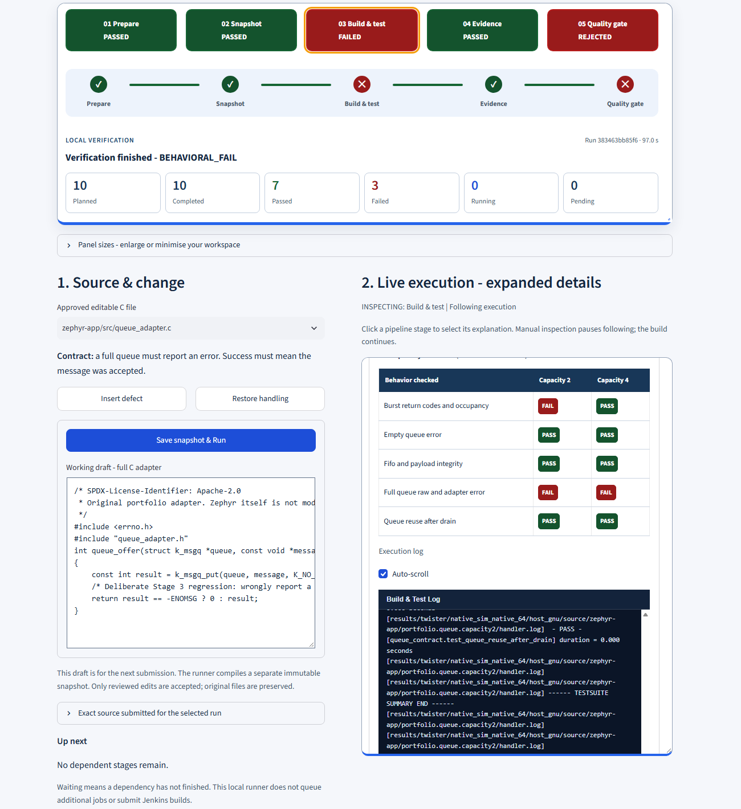

<picture>
<source media="(prefers-color-scheme: dark)" srcset="assets/engineering-dark.svg">

</picture>

## Embedded Software Development | Integration | Technical Delivery

**I'm Srinivas Reddy Mudem, with 11+ years of embedded software experience spanning C/C++ development, integration and software project leadership.**

My work combines software development, systematic debugging and technical delivery, with clear ownership, collaboration and verification.

**Explore:** [Embedded development & integration](case-studies/embedded-communication.md) · [Build automation & verification](case-studies/failure-to-recovery.md) · [Engineering investigation](case-studies/engineering-analysis.md)

## See the engineering in action

### 1. Embedded Communication & Diagnostics

Can the receiving software reconstruct exactly what the sender transmitted?

**Verified: 5/5 application bytes matched · 1 frame · 17/17 behavioral assertions passed.**

**Professional capability:** Embedded C development · Software integration · Protocol debugging · Fault investigation · Automated verification

I integrated an existing C ISO-TP implementation with two host endpoints, deterministic verification, frame tracing and controlled fault scenarios.

*Recorded local C execution. The animation replays observed frames; it is not physical CAN traffic or browser-side C execution.*

**[Inspect communication case study and evidence →](case-studies/embedded-communication.md)** · [Request a live local demonstration ↗](https://www.linkedin.com/in/srinivas-reddy-mudem-400181152/)

### 2. Embedded Build Reliability

The code compiled successfully. Behavioral tests still caught the defect.

**Green: 10/10 passed → Red: 7 passed, 3 failed → Recovery: 10/10 passed.**

**Professional capability:** Embedded test development · Build automation · CI/CD integration · Fault isolation · Regression verification

I integrated Zephyr RTOS verification into an isolated Jenkins/Docker workflow with controlled defect injection and source-linked test evidence.

*Recorded Jenkins executions; ten test executions across two queue configurations. The same assertions verified recovery.*

**[Inspect detected defect and verified recovery →](case-studies/failure-to-recovery.md)** · [Request a live local demonstration ↗](https://www.linkedin.com/in/srinivas-reddy-mudem-400181152/)

Recorded local Change & Verify — static preview

This preview comes from the separately verified local Docker/Twister demonstration. It is not a Jenkins run. Compilation succeeded, three behavioral assertions failed, and the local quality gate rejected the injected defect. A subsequent local repair passed all ten tests.

[Inspect the distinction between recorded Jenkins and local verification](case-studies/failure-to-recovery.md#recorded-jenkins-versus-live-local-demonstration). A live local demonstration is available on request.

### 3. Domain-Specific AI Agents

Turn an engineering question into a structured, reviewable investigation.

**Professional capability:** Python development · Structured engineering investigation · Response validation · Evidence traceability · Technical communication

**Question:** CAN node goes bus-off after three minutes, only when the engine is running.

| Part of the investigation | Example |
| --- | --- |
| Known | Engine-dependent bus-off symptom |
| Missing | Error counters, frame traces and electrical measurements |
| Next checks | Capture CAN errors and investigate signal integrity under the triggering conditions |

*Illustrative summary of an existing application example—not a new model execution or verified diagnosis. Engine dependence alone cannot rule out software.*

I developed **13 specialist engineering agents and eight domain knowledge packs**, with structured response contracts, specialist routing and targeted validators.

**441/441 offline software checks passed:** 363 agent checks and 78 calculator checks, using mocked provider responses. This is software verification, not a live model-accuracy benchmark.

**[▶ Try the live AI Agents demonstration](https://automotive-skilled-ai-agents.streamlit.app/)** · [Inspect the case study and validation →](case-studies/engineering-analysis.md)

A [separate deterministic evidence extension](case-studies/engineering-analysis.md#follow-the-evidence-from-failure-to-recovery) links recorded test failures to exact assertions, source revisions and verified recovery. That workflow does not perform model inference.

## How the results are verified

The demonstrations use retained execution records, unchanged regression checks and source-linked evidence. Recorded Jenkins results, local C demonstrations and offline AI software tests are separate verification activities. The ISO-TP communication and Zephyr queue workloads are separate implementations.

**My engineering approach:** Build on proven components, investigate problems systematically, verify behavior with repeatable tests, and deliver results backed by traceable evidence.

Full toolkit and standards context

**Embedded development:** C | ISO-TP | bounded UDS diagnostics | Zephyr RTOS

**Verification and delivery:** GCC | Clang | CMake/CTest | Ninja | Jenkins | Docker | Ztest/Twister | Cppcheck | gcovr | pytest

**Analysis and presentation:** Python | structured JSON | JUnit | standalone reports | source/artifact traceability | Streamlit

The agent knowledge packs include MISRA, ISO 26262, ASPICE and cybersecurity topics. Targeted checks support engineering review; they do not establish complete standards compliance. [Inspect assurance scope](case-studies/engineering-scope.md).

## Live demonstrations & contact

The [live AI Agents demonstration](https://automotive-skilled-ai-agents.streamlit.app/) is available to explore. Live local demonstrations of embedded communication, build/test verification and fault investigation are available on request.

These demonstrations show software behavior; physical hardware validation is outside the demonstrated scope.

**[Connect on LinkedIn →](https://www.linkedin.com/in/srinivas-reddy-mudem-400181152/)**
