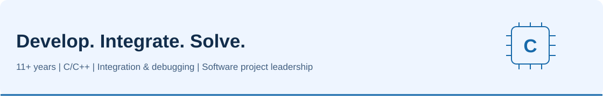
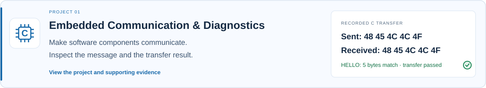
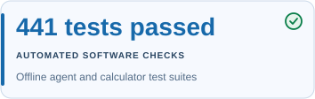
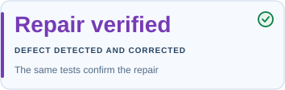

<picture>
<source media="(prefers-color-scheme: dark)" srcset="assets/engineering-dark.svg">

</picture>

## Embedded Software Development | Integration | Technical Delivery

**I'm Srinivas Reddy Mudem, with 11+ years of embedded software experience spanning C/C++ development, integration and software project leadership.**

I develop and debug embedded systems, explain difficult technical issues and help teams turn problems into verified solutions.

These projects show how I work: connect software components, detect problems through automated tests, and explain the findings so the next engineering decision is clear.

[Explore communication](case-studies/embedded-communication.md) | [See fault detection and recovery](case-studies/failure-to-recovery.md) | [Explore specialist AI agents](case-studies/engineering-analysis.md)

## See the engineering in action

### 1. Make software components communicate

**Problem:** Prove that the receiving software reconstructs the message correctly.

**My contribution:** Integrated existing C ISO-TP components with host tests, fault scenarios and frame visualization.

**Verified result:** Recorded C execution sent and received the same five HELLO bytes. The recorded frame trace and assertions confirm the transfer.

**Capability demonstrated:** Embedded integration, protocol debugging and repeatable verification.

**[Inspect transfer evidence →](case-studies/embedded-communication.md)** | [Request live local demo ↗](https://www.linkedin.com/in/srinivas-reddy-mudem-400181152/)

### 2. Detect a defect and verify the repair

**Problem:** Code can compile successfully but return the wrong result.

**My contribution:** Built isolated Jenkins/Docker/Zephyr verification with source-linked test evidence.

**Verified result:** The injected defect triggered three failed assertions. After repair, unchanged tests passed 10/10 in recorded Jenkins executions.

**Capability demonstrated:** Reproducible fault detection, CI/CD quality gates and verified recovery.

**[Inspect failure and recovery →](case-studies/failure-to-recovery.md)** | [Request live local demo ↗](https://www.linkedin.com/in/srinivas-reddy-mudem-400181152/)

### 3. Make engineering analysis easier to review

**Domain knowledge:** AUTOSAR · ISO 26262/HARA · ISO 21434/TARA · MISRA C · ASPICE · CAN · UDS · Embedded/RTOS patterns

**Problem:** Broad engineering advice is hard to act on without the facts, missing data and a concrete verification plan.

**My contribution:** Developed 13 specialist agents with eight knowledge packs, domain routing, structured investigations and targeted validation.

**Verified result:** 363 agent checks and 78 calculator checks passed offline. The public app supports specialist engineering questions; a separate isolated extension connects real test failures to source-linked evidence.

**Capability demonstrated:** Domain-focused assistance, reviewable analysis and evidence traceability.

**[▶ Try live AI Agents](https://automotive-skilled-ai-agents.streamlit.app/)** | [Inspect agent validation →](case-studies/engineering-analysis.md)

## Evidence behind the examples

  

[Inspect the 441 passing offline tests](case-studies/agent-test-evidence.md): 363 agent checks and 78 calculator checks. This count is specific to those suites; it does not measure every AI answer or combine all three projects.

## The engineering approach connecting the work

| Build on proven software | Investigate the exact failure | Verify before accepting a fix |
| --- | --- | --- |
| Reuse existing components and preserve their attribution | Compare expected and actual behavior, then inspect the related code | Run the unchanged checks and retain source-linked results |

The automotive communication workload and Zephyr queue workload are separate implementations. They demonstrate a shared engineering approach, not one combined runtime.

Full toolkit and standards context

**Embedded development:** C | ISO-TP | bounded UDS diagnostics | Zephyr RTOS

**Verification and delivery:** GCC | Clang | CMake/CTest | Ninja | Jenkins | Docker | Ztest/Twister | Cppcheck | gcovr | pytest

**Analysis and presentation:** Python | structured JSON | JUnit | standalone reports | source/artifact traceability | Streamlit

The agent knowledge packs include MISRA, ISO 26262, ASPICE and cybersecurity topics. Targeted checks support engineering review; they do not establish complete standards compliance. [Inspect assurance scope](case-studies/engineering-scope.md).

## Live demo & contact

**Try it yourself:** [Open the Domain-Specific AI Agents live demo](https://automotive-skilled-ai-agents.streamlit.app/).

Live local demonstrations of embedded communication, build/test verification and fault investigation are available on request.

Implementation repositories remain private. These portfolio examples demonstrate software behavior; they do not claim physical hardware validation.

[Connect on LinkedIn](https://www.linkedin.com/in/srinivas-reddy-mudem-400181152/)
