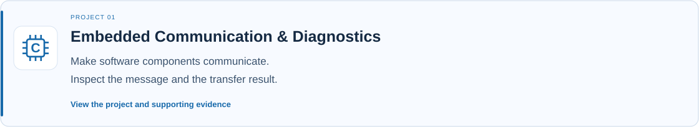
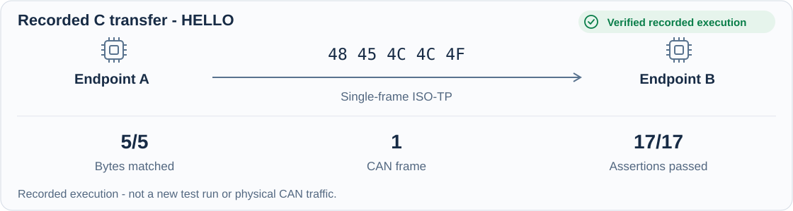
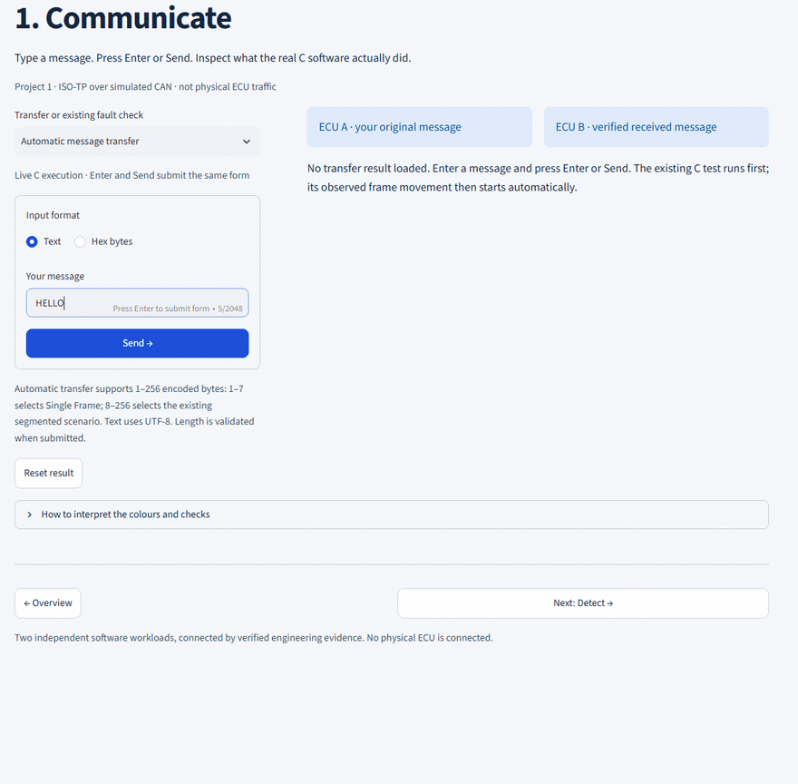

[← Back to Engineering Portfolio](../README.md)

*Engineering Portfolio / Case Study 01 of 03 · Embedded Communication*

# Embedded Communication & Diagnostics

**[▶ Watch the recorded HELLO transfer](#watch-a-recorded-hello-transfer)**

A successful send operation does not prove that the receiver reconstructed the correct application message. This project uses repeatable C tests to inspect the actual frames, received bytes and supported fault behavior.

**Verified result:** The recorded C execution transmitted and reconstructed five matching application bytes (`48 45 4C 4C 4F`, representing "HELLO"). The frame trace and behavioral assertions support the result.

## My engineering contribution

I integrated a pinned upstream ISO-TP implementation with a hardware-free C host adapter, deterministic simulated time, two independent endpoints and controlled fault scenarios. I connected genuine C execution results to frame traces, behavioral tests and reproducible structured evidence, while preserving upstream attribution.

**Professional capability:** Embedded C integration, interface reasoning, protocol debugging and repeatable verification.

Official project: **Automotive Embedded Integration & CI/CD Platform**. Implementation repository: `automotive-embedded-integration-cicd-platform` (private).

## Watch a recorded HELLO transfer

Watch HELLO submitted to the compiled C transport, then follow the observed frame from Endpoint A to Endpoint B. The receiver reconstructs the same five application bytes, with **17/17 behavioral assertions passing**.

*Recorded local C execution. Frame movement replays observed events, not physical CAN traffic or browser-side C execution.*

[Inspect this recording's execution evidence](../evidence/communication-recording.json) · [View the readable final state](../assets/communication-final-state.png)

Recording identity and historical evidence

This demonstration was recorded on 22 October 2026. Run identity: `2f35453e774e49dc977d239ede488289`. Native source revision: `a395087926b68898ebf8cc85a5f2d05fcb3eab77`.

Its five application bytes (`48 45 4C 4C 4F`), frame (`05 48 45 4C 4C 4F 00 00`) and 17 passing assertions match the historical HELLO example. It is a separate execution from the historical revision `23fa0d2e28945609d0811dc6dd1a1cbdfe43d710` documented below. The original evidence is preserved unchanged.

## Technologies & Tools

**Communication:** `C` · `ISO-TP` · `CAN frame representation` · `UDS test scenarios (limited scope)`

**Build & verification:** `GCC` · `Clang` · `CMake/CTest` · `Ninja`

**Analysis & coverage:** `Cppcheck` · `gcovr`

**Evidence & tests:** `Python` · `pytest`

## What you can explore

The local demonstrator supports the following engineering walkthrough. This static case study presents recorded evidence; it does not run the C executable in your browser.

| Explore | What you can inspect |
| --- | --- |
| Run a supported message transfer | Genuine compiled C execution, input byte length and received bytes |
| Inspect the frames | Actual direction, frame sequence and application bytes |
| Compare short and segmented transfers | How supported single-frame and multi-frame scenarios differ |
| Inject a supported fault | The observed protocol outcome and its expected assertions |
| Review the evidence | Source identity, assertion results and reproduction details |

**A fault test can pass because the expected communication failure was correctly detected.** Successful fault detection is different from successful message delivery.

## Technical evidence

### Recorded HELLO transfer

| Evidence item | Recorded value |
| --- | --- |
| Application payload | `48 45 4C 4C 4F` - five ASCII bytes representing HELLO |
| Received payload | `48 45 4C 4C 4F` - matches the input |
| CAN frame bytes | `05 48 45 4C 4C 4F 00 00` |
| Direction | Endpoint A to endpoint B |
| CAN identifier | `0x700` |
| Frames emitted | 1 |
| Behavioral assertions | 17 passed in this recorded single-frame example |
| Compiler | GNU 13.3.0 |
| Integration source revision | `23fa0d2e28945609d0811dc6dd1a1cbdfe43d710` |
| Upstream ISO-TP revision | `5593428d95af10dde1e565cebcda16089fc74857` |

The leading `05` encodes the ISO-TP single-frame payload length. The final zeros are padding. Neither is part of the five application bytes of HELLO.

[Inspect recorded payloads, frames and assertions](../evidence/communication-excerpt.json).

### Verified fault example - Missing flow control

The recorded sender still waits at 100 ms of injected time and reports this implementation’s `TIMEOUT_BS` result (`-2`) at 101 ms. The receiver exposes no complete application message. All 17 behavioral assertions passed, giving an **EXPECTED_FAULT** verdict: correct fault detection, not successful delivery. These are simulated protocol times, not wall-clock performance measurements. [Inspect the recorded fault frames and assertions](../evidence/communication-fault-excerpt.json).

### Execution scope

Frame visualization replays events recorded from the C executable; it does not represent physical CAN traffic. The existing application runs the supported C scenario first and then presents the observed frame sequence. Animation completion alone is not a successful-transfer verdict.

The HELLO recording demonstrates the stated single-frame transfer, not every segmented or fault scenario. Those have their own supported inputs and test results. The demonstrator's input limits apply; the UI does not add protocol functionality.

The visual is derived from recorded execution evidence, not a screenshot. The demonstration uses host-executed C software and does not claim physical ECU validation.

[Inspect communication evidence →](../evidence/communication-excerpt.json) · [Request live local demo ↗](https://www.linkedin.com/in/srinivas-reddy-mudem-400181152/)

---

**[Next: Embedded Build Reliability →](failure-to-recovery.md)** · [← Back to Engineering Portfolio](../README.md) · [Connect on LinkedIn ↗](https://www.linkedin.com/in/srinivas-reddy-mudem-400181152/)
