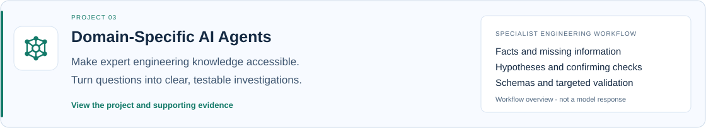
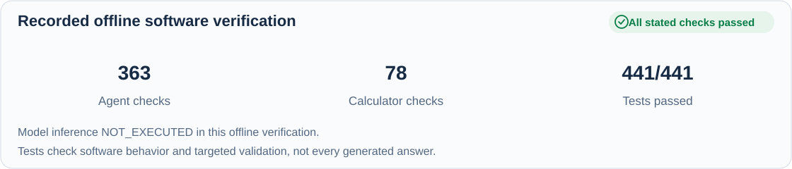
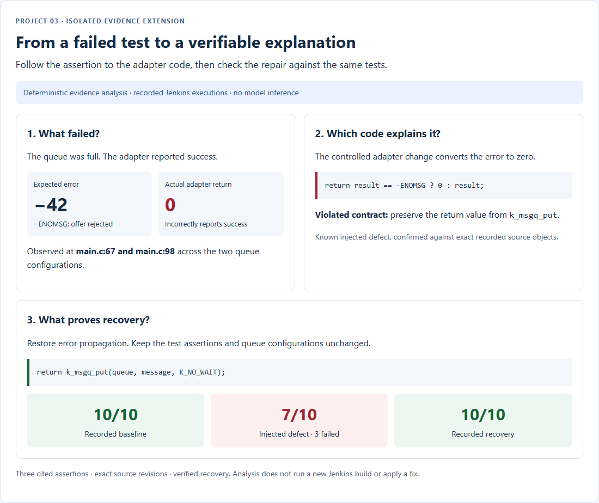

[← Back to Engineering Portfolio](../README.md)

*Engineering Portfolio / Case Study 03 of 03 · Engineering Analysis*

# Domain-Specific AI Agents

**Domain knowledge:** AUTOSAR · ISO 26262/HARA · ISO 21434/TARA · MISRA C · ASPICE · CAN · UDS · Embedded/RTOS patterns

**Goal: Make specialist engineering knowledge and structured problem-solving easier to access and apply.**

13 specialist agents help organize embedded-software questions into clear investigations: what is known, what is missing and what to check next.

## Verified software results

363 agent checks and 78 calculator checks passed offline with mocked providers. These verify software behavior, not live model accuracy.

**[▶ Try the live AI Agents demonstration](https://automotive-skilled-ai-agents.streamlit.app/)** | [Inspect validation evidence →](agent-test-evidence.md)

## My engineering contribution

I built the Python/Streamlit application with **13 specialist agents, eight knowledge packs, structured response schemas and targeted validation**. It supports development, testing, integration/FAE and technical-lead workflows.

**Professional capability:** Python development · Structured engineering investigation · Response validation · Evidence traceability · Technical communication

## One question. Two response styles.

**Question:** "CAN node goes bus-off after 3 minutes, only when engine running."

**Illustrative built-in example—not a verified diagnosis. Its assumptions, thresholds and calculations require engineering review. Engine dependence alone cannot rule out software.**

<table class="response-comparison"><thead><tr><th scope="col">Generic answer</th><th scope="col">Domain-specific answer</th></tr></thead><tbody><tr><td><pre class="generic-answer">&quot;Check your CAN bus wiring&#10; and termination. Verify&#10; baud rate settings are&#10; consistent across all&#10; nodes...&quot;</pre></td><td>

<strong>Protocol:</strong>
<pre>CAN | HIGH confidence</pre>

<strong>Data:</strong>
<pre>PARTIAL — oscilloscope trace required&#10;            to confirm ripple vs GND offset</pre>

<strong>Facts:</strong>
<pre>bus-off after 3 min, engine-running dependency</pre>

<strong>Assumptions:</strong>
<pre>~1 msg/s TX rate (not provided)&#10;            single node affected (not confirmed)</pre>

<strong>Basis:</strong>
<pre>bus-off after 3 min&#10;  → TEC accumulation, intermittent errors&#10;  only when engine running&#10;  → engine-coupled noise source</pre>

<strong>OSI Layer:</strong>
<pre>L1 Physical</pre>

<strong>AUTOSAR Layer:</strong>
<pre>MCAL (CanDrv)</pre>

<strong>Tool:</strong>
<pre>Oscilloscope&#10;  - Diff probe on CAN_H/CAN_L (signal integrity)&#10;  - Single-ended probe on Vcc (ripple check)</pre>

<strong>TEC Math:</strong>
<pre>Net climb = 256 / 180s&#10;              = 1.41 TEC/s&#10;  Bus-off: ~181s — 3 min ✓</pre>

<strong>Ruled Out:</strong>
<pre>Software issue — engine-dependent symptom&#10;                   contradicts SW fault&#10;  Bus overload   — does not match gradual&#10;                   TEC-driven failure pattern</pre>

<strong>Causes:</strong>
<pre>[HIGH]   Alternator ripple (most likely)&#10;           Engine-running maps to supply noise&#10;           Vcc AC-coupled&#10;           Pass &lt; 200mV / Fail &gt; 500mV&#10;&#10;  [MEDIUM] GND offset&#10;           Condition-dependent noise possible&#10;           but less consistent&#10;           Pass &lt; 50mV / Fail &gt; 200mV</pre>

<strong>Decision Flow:</strong>
<pre>Vcc + GND OK?&#10;  +-- No  --&gt; Fix supply&#10;  +-- Yes --&gt; Error frames?&#10;      +-- No  --&gt; Check thermal drift&#10;                  (heat gun on transceiver)&#10;      +-- Yes --&gt; L1/L7</pre>

<strong>Next Action:</strong>
<pre>Measure Vcc ripple at transceiver pin&#10;  with engine at 2000 RPM</pre>

<strong>Contradictions:</strong>
<pre>None — inputs consistent with&#10;  TEC-driven bus-off behaviour</pre>
</td></tr></tbody></table>

## Follow the evidence from failure to recovery

The separate isolated evidence extension connects recorded test failures to exact assertions and source revisions. It verifies the known controlled defect and its recorded repair; it does not claim that the public AI Agents demonstration independently diagnosed the failure.

**Observed:** a full queue returned `-ENOMSG` (`-42` in this environment), but the controlled adapter reported `0`. Three assertions rejected that contradiction: capacity 2 at `main.c:67`, and capacities 2 and 4 at `main.c:98`.

**Verified code relationship:** the recorded adapter maps `-ENOMSG` to success. Restoring error propagation returns the same assertions to PASS in the retained Jenkins recovery.

*Deterministic analysis of recorded Jenkins builds #2, #3 and #4 and exact Git source objects. Model inference NOT_EXECUTED. No new build, Jenkins run or automatic repair is performed by this review.*

[Inspect failed assertions and recovery](failure-to-recovery.md#technical-evidence) · [Request a guided local investigation demonstration ↗](https://www.linkedin.com/in/srinivas-reddy-mudem-400181152/)

The excerpt verified twelve source hashes across Green, Red and Recovery. It uses the historical Jenkins executions, separately from the fresh local Change & Verify recording in the Build Reliability case study.

Source references & raw investigation evidence

[Raw findings, evidence references and source identities (JSON)](../evidence/investigation-excerpt.json).

Technologies, specialist coverage and technical evidence

## Technologies & Tools

**Application:** `Python` · `Streamlit`

**Response contracts:** `Pydantic` · `JSON schemas`

**Verification:** `pytest` · `JUnit`

**Provider adapters:** `Groq SDK` · `Google Gen AI SDK`

Knowledge packs cover CAN, UDS, embedded patterns, AUTOSAR, MISRA, ASPICE, ISO 26262/HARA and ISO 21434/TARA. These are domain references and review contexts, not a claim of complete standards compliance.

## What the application helps you investigate

| Engineering responsibility | Implemented specialists | Example task |
| --- | --- | --- |
| Development | Embedded C, AUTOSAR BSW, MISRA review | Investigate a hard fault, plan an interface or review a reported coding-rule finding |
| Integration and FAE | CAN analysis, field debugging, software integration | Structure a bus-off investigation, interpret a diagnostic issue or investigate a build/interface failure |
| Testing | Unit testing, SIL/HIL planning, regression analysis | Propose boundary tests, plan verification or assess changed test results |
| Technical leadership | Software project lead, ASPICE coach, safety/cyber lead, gate review | Structure change-impact, risk and readiness investigations |

These are assistance workflows. Tool references and SIL/HIL plans do not mean the application executes those external tools or physical test benches.

## What makes the answer reviewable

| Part of the investigation | What the implemented response models support |
| --- | --- |
| Facts and assumptions | Separate information supplied by the engineer from inferred context |
| Missing information | Identify insufficient data and the measurements needed next |
| Diagnostic context | Identify protocol, software layer or engineering process where supported |
| Candidate causes | Link observations to hypotheses and proposed confirming checks |
| Verification plan | Suggest a tool, measurement and pass/fail criteria where supported |
| Calculations and consistency | Show agent-specific calculations and apply selected deterministic validation rules |

The fields vary by specialist. Pydantic schemas define the response structure; agent-specific Python validators check selected consistency conditions. Failed schema/domain checks can trigger bounded retries with feedback.

## Verified software behavior

[Inspect the test scope and retained JUnit](agent-test-evidence.md).

Inspect software validation details

### A concrete mathematical validation check

The software-project-lead validator checks that a supplied risk score equals probability multiplied by impact. I exercised the existing function offline with two authored inputs:

| Input | Required score | Supplied score | Actual validator result |
| --- | --- | --- | --- |
| Probability 3, impact 4 | `3 x 4 = 12` | `12` | Accepted |
| Probability 3, impact 4 | `3 x 4 = 12` | `11` | Rejected with the score mismatch |

This demonstrates one implemented consistency check using authored fixtures. It is not a generated model answer or a benchmark of every numerical field. For example, the CAN validator checks for numeric content in some calculation fields; it does not independently recompute all CAN arithmetic.

### Routing and execution scope

The UI scores domain keywords and supports specialist selection. In five focused source-function checks, four prompts selected the intended specialist. One generic regression prompt selected the integration agent instead of the regression analyst. Routing is therefore a heuristic, not a guaranteed classifier; the actual finding is retained in the review evidence.

[Inspect the source identities, routing results and mathematical check](../evidence/agent-implementation-review.json).

## Connection to the other portfolio projects

A separate isolated copy, `automotive-lifecycle-agents-evidence`, adds deterministic processing of genuine Project 1/2 reports. It links the Zephyr queue failures to expected `-42` versus actual `0`, the affected assertions and recorded recovery. That workflow validates evidence references and provenance; it is not the public app automatically running Jenkins or discovering an arbitrary source defect.

The [recorded queue results and failed assertions](failure-to-recovery.md#technical-evidence) remain inspectable. Model inference in the offline evidence workflow is **NOT_EXECUTED**. The public specialist-agent application is the separate provider-backed demonstration.

### Notes on the copied example

The side-by-side example is reproduced verbatim from the app. Its proposed causes and thresholds are illustrative and require investigation-specific evidence. Engine dependence alone cannot rule out software. The displayed `256 / 180` calculation rounds to approximately `1.42`, rather than `1.41`; the copied example is not silently corrected or presented as validated arithmetic.

## Scope and trust

The strongest implemented safeguards are explicit response contracts, selected deterministic checks and retained test evidence. They help expose missing or inconsistent information; they do not guarantee every hypothesis, threshold or recommendation is correct. Engineering review remains necessary. The original application files remain unchanged. No credentials were read and no provider calls were made during this review.

---

**[Next: Embedded Communication & Diagnostics →](embedded-communication.md)** · [← Back to Engineering Portfolio](../README.md) · [Connect on LinkedIn ↗](https://www.linkedin.com/in/srinivas-reddy-mudem-400181152/)
