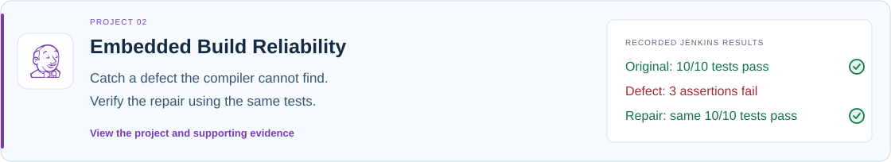
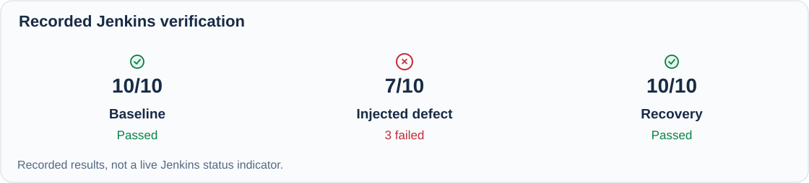
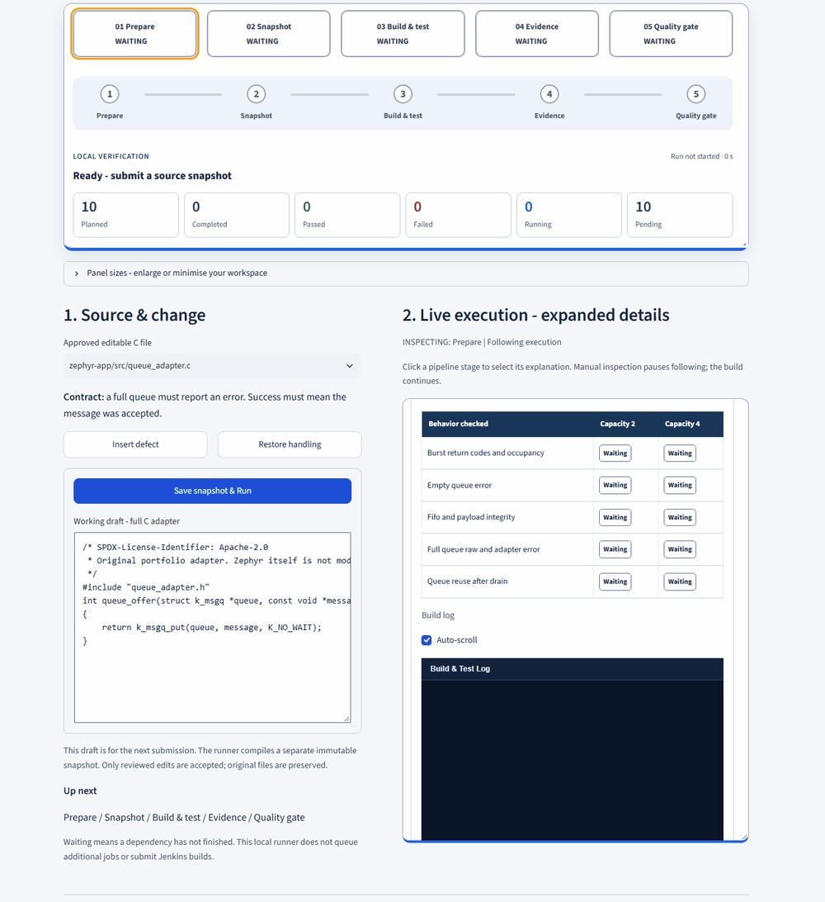

[← Back to Engineering Portfolio](../README.md)

*Engineering Portfolio / Case Study 02 of 03 · Build Reliability*

# Embedded Build Reliability

**Detecting a defect that compilation missed.**

A deliberately introduced queue-adapter defect falsely reported success when the queue was full. Automated behavioral tests detected it. Controlled recovery restored all 10 passing test executions without changing their assertions.

**[▶ Watch the defect detection and recovery](#watch-the-defect-detection-and-recovery)**

## Recorded Jenkins verification

Each recorded Jenkins run contained 10 test executions across two queue configurations. The deliberately defective revision produced three failed executions; recovery restored all 10 passing executions without changing the assertions.

## My engineering contribution

I integrated Zephyr Twister/Ztest verification into an isolated Jenkins/Docker workflow, retained source-linked verification artifacts and implemented deterministic reporting to compare the baseline, injected defect and recovery.

**Professional capability:** Embedded debugging, reproducible CI/CD verification, fault isolation and reviewable technical decisions.

Official project: **Embedded CI/CD Reliability Platform**. Implementation repository: `embedded-cicd-reliability-platform` (private).

## Watch the defect detection and recovery

Change the reviewed C adapter, execute isolated verification, and follow the actual build and test output. Compilation succeeds, three behavioral assertions fail, and the local quality gate rejects the defective snapshot. Restoring error propagation returns all ten test executions to PASS.

*Recorded local Change & Verify execution, separate from the retained Jenkins runs above. Execution portions replay at 8× speed, with pauses at source changes and verified outcomes. Captured elapsed times remain visible.*

[Inspect this recording's source-linked results](../evidence/reliability-local-recording.json) · [View the failed final state](../assets/reliability-local-red.png) · [View the recovered final state](../assets/reliability-local-recovery.png)

| This local recording | Executed | Passed | Failed | Local quality gate |
| --- | --- | --- | --- | --- |
| Injected adapter defect | 10 | 7 | 3 | Rejected |
| Error propagation restored | 10 | 10 | 0 | Passed |

The same test identities and configuration scope were verified across both runs; 888 artifact hashes were checked per execution. The approved source edits are compiled as separate immutable snapshots. The browser does not modify the original repository, push changes or trigger Jenkins.

Local recording identities and execution boundaries

Recorded on 22 October 2026. Defect run: `12e24c9cb5c14f77b688a99939ff2544` (67.63 seconds). Recovery run: `f6b4757e29f940a78725f83513065142` (89.28 seconds).

These are source snapshots, not newly committed revisions. The evidence records the base commit, adapter template revision, complete submitted source hashes and diff. The local repair preserves the error by returning `result`; the historical Jenkins recovery separately restored the original direct `k_msgq_put` return. Their identities are not interchangeable.

Existing pinned offline container; network disabled; 2 CPUs / 2 GiB. Jenkins execution NOT_EXECUTED. Model inference NOT_EXECUTED. Physical hardware validation NOT_PERFORMED.

## Technologies & Tools

**Embedded execution:** `C` · `Zephyr RTOS` · `Twister/Ztest`

**CI & isolation:** `Jenkins` · `Docker` · `Git`

**Build toolchain:** `CMake` · `GCC`

**Evidence reporting:** `Python`

CMake configures the Zephyr application build and GCC compiles the native target. Twister/Ztest executes the queue checks. Jenkins orchestrates isolated verification, Docker bounds the execution environment, and Python produces source-linked reports.

## Failure mechanism

**Expected: `-ENOMSG` (`-42` in this environment) → Actual: `0` (false success).**

The queue rejected the message, but the adapter hid the error. A caller could therefore incorrectly believe the message had been accepted. The controlled mutation compiled successfully; this was a behavior failure, not a build or infrastructure failure.

For the four-message burst, a two-message queue should accept two messages and reject two. A four-message queue should accept all four. Synchronization prevents the consumer from draining the queue during that burst.

Three assertions detected the defect: one burst-behavior check for capacity 2, and two explicit full-queue error checks, one for each capacity. Capacity 4's four-message burst still passed; its separate full-queue check failed.

## Technical evidence

[Inspect recorded source revisions, counts and assertion evidence](../evidence/recorded-recovery-summary.json).

The following identities refer to retained recorded executions. This page does not rerun Jenkins. The image above is evidence-derived artwork, not a screenshot or live pipeline status.

| Recorded execution | Full source revision | Executed | Passed | Failed |
| --- | --- | --- | --- | --- |
| Original Green | `7c8505541580c93697dfbcec09662b89e0edffa2` | 10 | 10 | 0 |
| Deliberate Red | `2988a4d50901ce0b640e94f5b5b08e366615ebce` | 10 | 7 | 3 |
| Recovery | `1f343d0d212e9140665b6f7213ba2acb7475b318` | 10 | 10 | 0 |

| Failed check in Red | Queue capacity | Source location | Expected | Actual |
| --- | --- | --- | --- | --- |
| Burst error propagation | 2 messages | `main.c:67` | `-42` | `0` |
| Explicit full-queue adapter result | 2 messages | `main.c:98` | `-42` | `0` |
| Explicit full-queue adapter result | 4 messages | `main.c:98` | `-42` | `0` |

### Recorded Jenkins versus live local demonstration

The Green/Red/Recovery results above come from recorded Jenkins executions. The local showcase separately supports a bounded adapter experiment through the existing Docker/Twister runner. It is not a newly triggered Jenkins build, and its editor accepts approved variants rather than arbitrary code.

This is a controlled regression experiment, not an independently discovered production defect or automatic diagnosis of arbitrary firmware. The Zephyr queue workload is separate from the ISO-TP communication workload. The public evidence is a curated summary; raw Jenkins archives and implementation source remain private.

## Why the result is trustworthy

**The same assertions were used throughout. Recovery restored correct adapter behavior rather than changing the tests to obtain a passing result.** Source/configuration identities and retained integrity checks support comparison across equivalent execution scopes.

[Inspect evidence analysis →](engineering-analysis.md) · [Request live local demo ↗](https://www.linkedin.com/in/srinivas-reddy-mudem-400181152/)

---

**[Next: Domain-Specific AI Agents →](engineering-analysis.md)** · [← Back to Engineering Portfolio](../README.md) · [Connect on LinkedIn ↗](https://www.linkedin.com/in/srinivas-reddy-mudem-400181152/)
